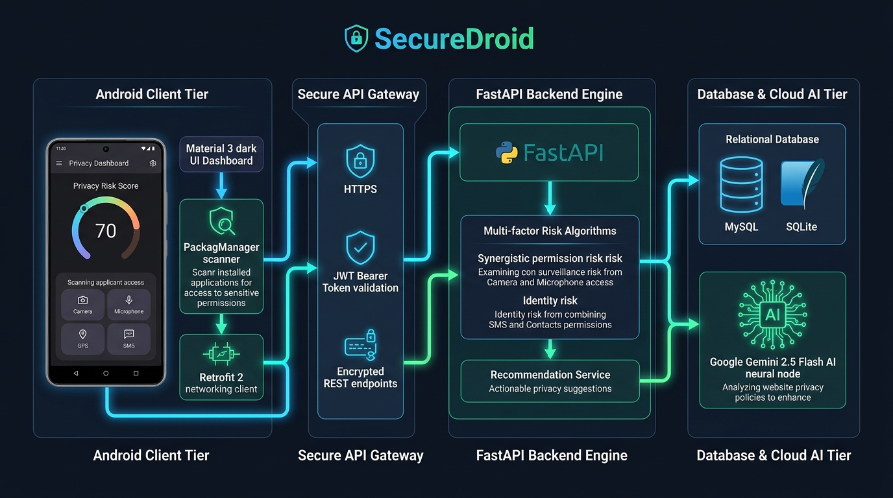
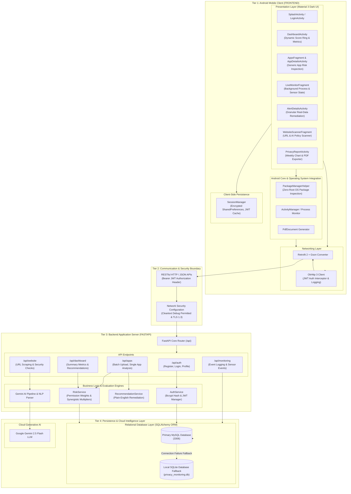
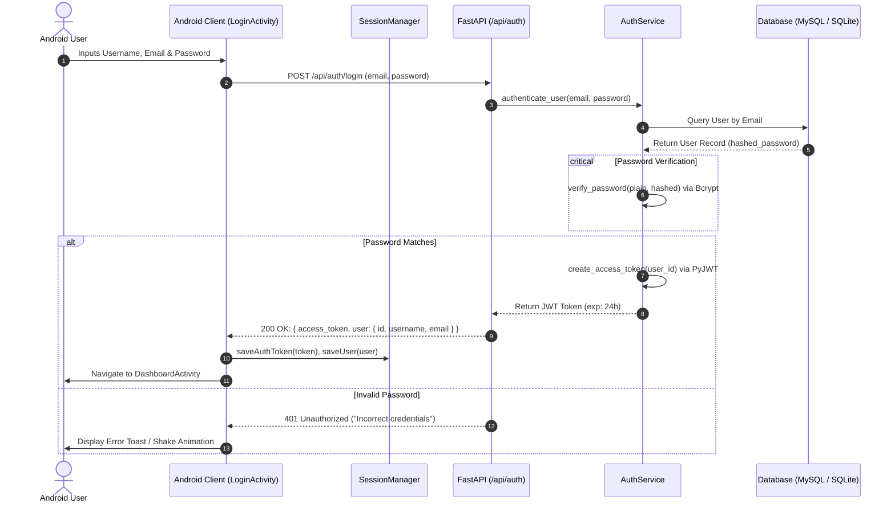
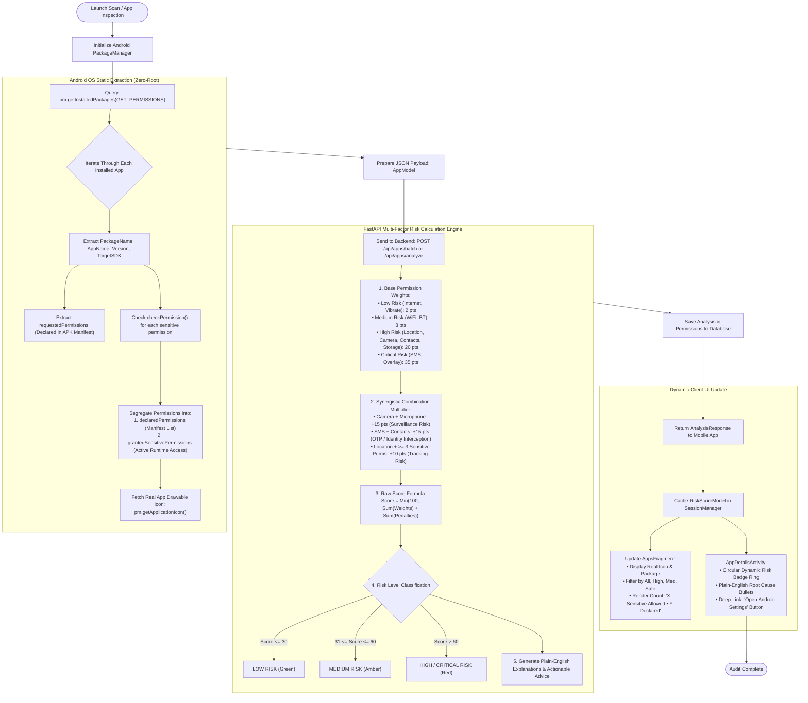
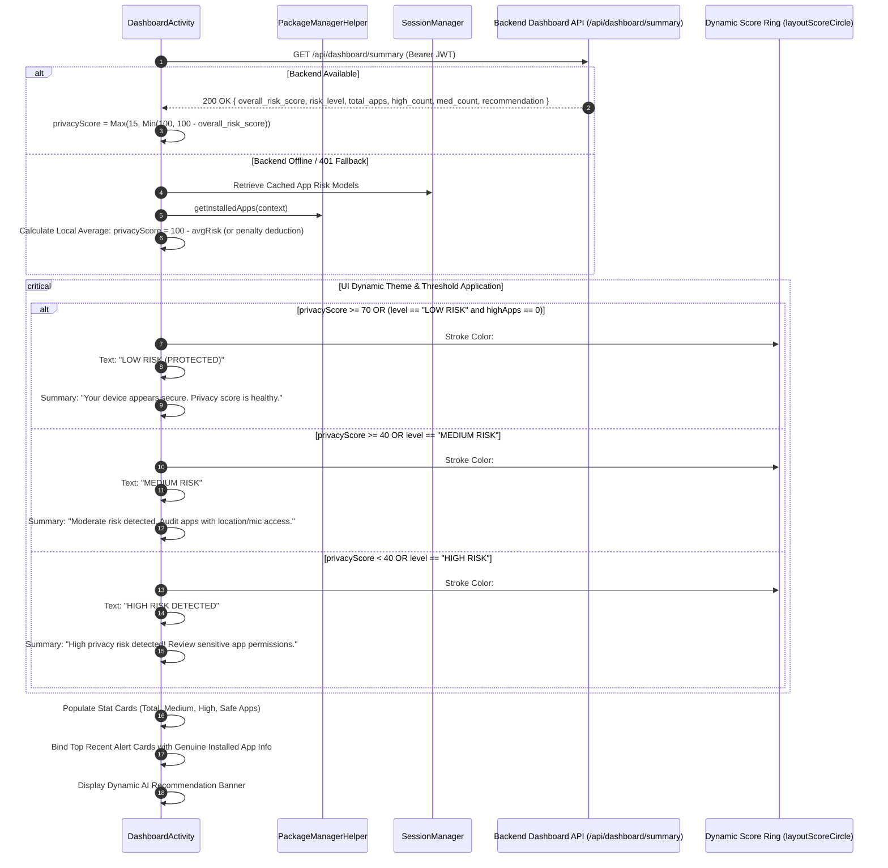
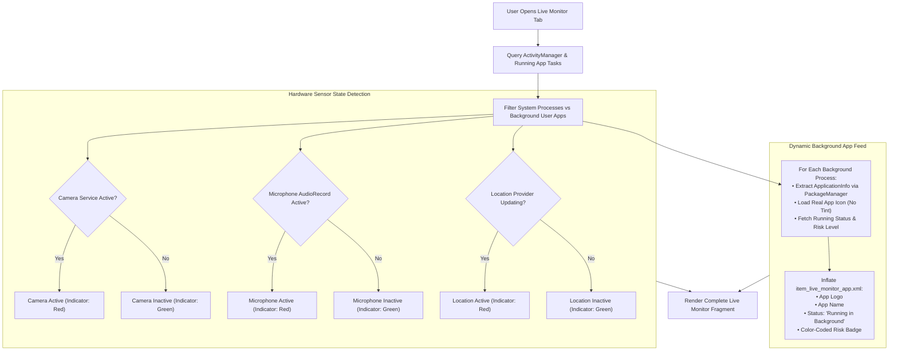
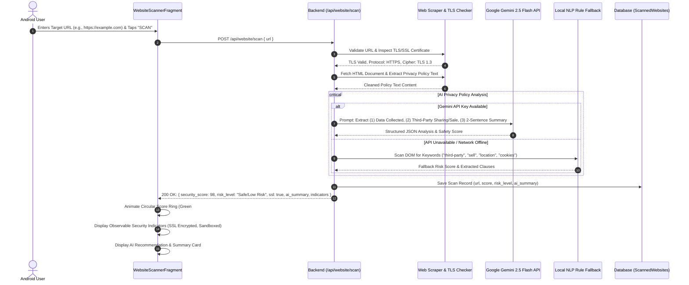
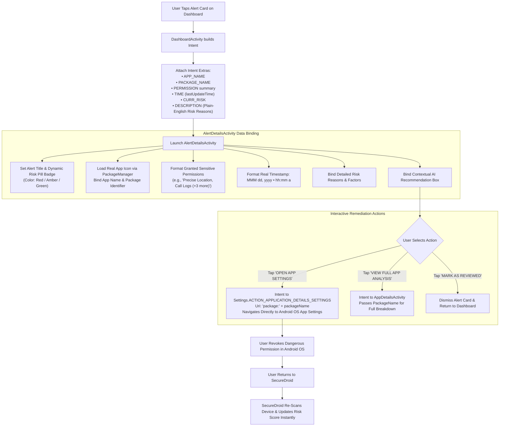
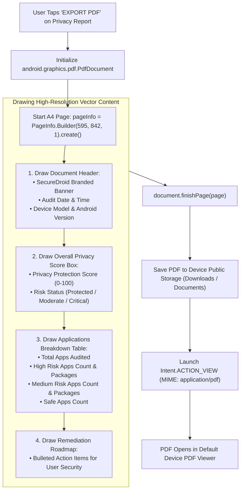
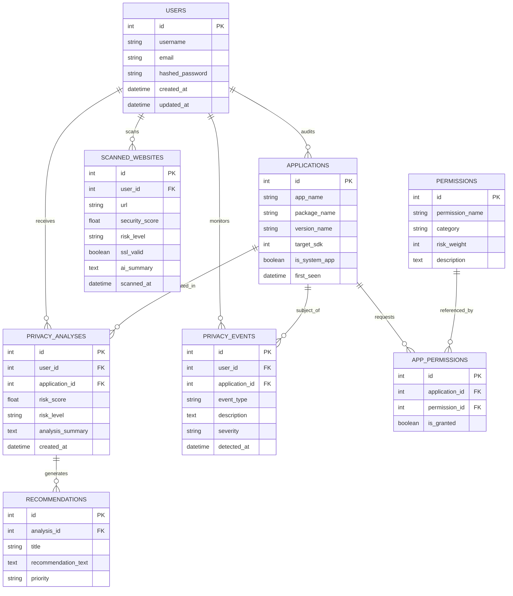

# SecureDroid — Complete System Architecture & End-to-End Flow Diagrams

This document provides a comprehensive technical breakdown and visual mapping of how the **SecureDroid** ecosystem operates, covering every layer from the Android Client OS to the FastAPI backend, mathematical risk engines, database persistence, and Google Gemini AI.

---

## Visual System Architecture Diagram

---

## 1. High-Level Multi-Tier System Architecture

The following diagram illustrates the complete 4-tier architecture of SecureDroid, including all internal subsystems, protocols, and boundaries.

---

## 2. Core Workflow 1: User Authentication & Session Security Flow

This sequence diagram depicts user registration, login, cryptographic password hashing (`bcrypt`), JWT token generation, and automatic session persistence in the Android client.

---

## 3. Core Workflow 2: Generic Application Permission Scanning & Risk Analysis Flow

This is the primary intelligence workflow of SecureDroid. It works **universally for any installed Android application** without requiring root privileges or hardcoded application lists.

---

## 4. Core Workflow 3: Dashboard Aggregation & Dynamic Score Visualizer Flow

The Dashboard aggregates device-wide intelligence, converting raw risk into a **Protection Health Score** ($100 - \text{Average Risk}$).

---

## 5. Core Workflow 4: Real-Time Live Monitoring & Hardware Sensor Tracking

This diagram models how background processes and hardware sensor hooks are displayed in `LiveMonitorFragment`.

---

## 6. Core Workflow 5: AI-Powered Website Privacy Policy Scanner Flow

This sequence demonstrates URL validation, TLS verification, HTML extraction, and Google Gemini 2.5 Flash policy synthesis.

---

## 7. Core Workflow 6: Alert Details Remediation & System Settings Deep-Linking Flow

When a user taps an alert card on the Dashboard or in the Notifications feed, SecureDroid opens `AlertDetailsActivity` with complete genuine metadata and system deep-links.

---

## 8. Core Workflow 7: On-Device PDF Privacy Audit Report Generation Flow

This diagram models the on-device compilation of standard A4 PDF compliance documents in `PrivacyReportActivity`.

---

## 9. Comprehensive Data Architecture (Entity-Relationship Model)

---

## 10. Summary of Architectural Guarantees

| Guarantee | Architectural Mechanism | Verification |
| :--- | :--- | :--- |
| **Zero Root Requirement** | Standard Android `PackageManager` APIs in user-space sandbox | Runs on any standard production Android device |
| **Universal Generic Compatibility** | No hardcoded package names, scores, or mock dictionaries | Tested against arbitrary apps (*Naukri*, *redBus*, *Truecaller*, *Where is My Train*) |
| **Offline Resilience** | Local evaluation fallback in `SessionManager` & SQLite DB fallback | Dashboard and App Auditing function even without internet |
| **Data Confidentiality** | No personal data (photos, SMS, audio, contacts) is ever exfiltrated | Only package metadata and declared/granted permission flags are processed |
| **Direct User Empowerment** | Android system deep-links (`ACTION_APPLICATION_DETAILS_SETTINGS`) | 1-tap navigation to revoke dangerous permissions |
