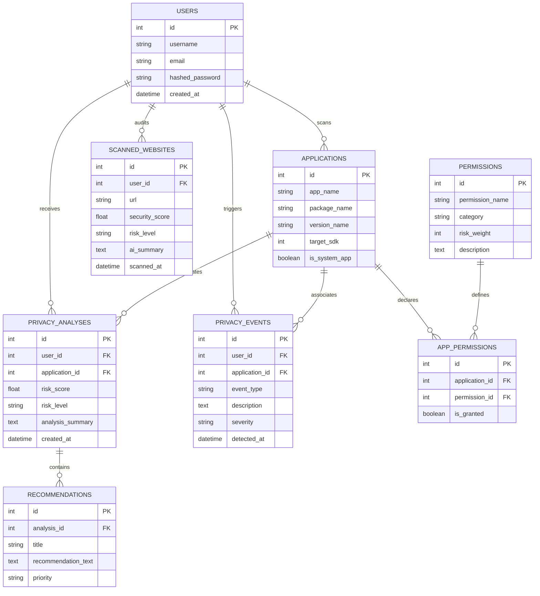

# Product Requirements Document (PRD)

# SecureDroid: Generic Android Privacy & Permission Intelligence System

---

| Document Attribute | Details |
| :--- | :--- |
| **Product Name** | **SecureDroid** |
| **Document Version** | **1.0.0 (Production / Release)** |
| **Status** | **Approved & Active** |
| **Target OS / Platform** | **Android 7.0+ (Min SDK: 24, Target SDK: 36)** |
| **Backend Architecture** | **Python 3.10+ / FastAPI / SQLAlchemy / SQLite & MySQL** |
| **AI / NLP Engine** | **Google Gemini 2.5 Flash / Rule-Based NLP Fallback** |
| **Primary Authors** | **SecureDroid Engineering & Security Team** |
| **Last Updated** | **October 2026** |

---

## 1. Executive Summary & Problem Statement

### 1.1 Problem Statement
Modern Android applications frequently request access to high-risk hardware sensors, personal data repositories, and background services (such as GPS Location, Camera, Audio Recording, Contacts, SMS, and Storage). Users encounter two major privacy challenges:
1. **Blind Permission Acceptance**: Users accept permission requests at runtime or installation without understanding what capabilities are granted or how permissions combine synergistically to create severe privacy hazards (e.g., Camera + Microphone enabling covert surveillance, or SMS + Contacts facilitating OTP interception).
2. **Incomprehensible Legal Policies**: Online services and accompanying websites use lengthy, convoluted privacy policies written in dense legal terminology that disguise aggressive third-party data tracking, broker sales, and weak retention safeguards.
3. **Lack of Continuous Device Context**: Default Android OS settings present permission status on an isolated, per-app basis without providing an aggregated Device Privacy Health Score or historical audit timeline.

### 1.2 Product Vision
**SecureDroid** is an enterprise-grade mobile security and privacy intelligence system. It provides real-time, zero-root permission audits for **all installed Android applications**, quantifies application and device-level exposure through a **multi-factor synergistic risk scoring algorithm**, translates legal privacy policies using **generative AI and NLP**, and empowers users with actionable remediation workflows (revocation deep-links, privacy reports, and exportable audit documents).

---

## 2. Product Objectives & Success Metrics (KPIs)

### 2.1 Core Objectives
- **Generic Zero-Root Analysis**: Audit any third-party or system Android application dynamically using genuine package manager metadata without hardcoded packages or synthetic mock scores.
- **Explainable Synergistic Risk Scoring**: Evaluate not only standalone permission weights but also identify dangerous multi-permission combinations (e.g., Location + SMS + Camera) that amplify privacy vulnerability.
- **Generative AI Privacy Synthesis**: Parse and summarize public website privacy policies within seconds, flagging trackers, third-party data sales, and retention risks.
- **Offline & Low-Bandwidth Resilience**: Provide local caching, local permission evaluations, and graceful fallback when remote backend servers or databases are unreachable.

### 2.2 Success Metrics (KPIs)
| Metric | Target | Verification Method |
| :--- | :--- | :--- |
| **Permission Audit Accuracy** | 100% parity with Android `PackageManager` | On-device package inspection across system & user apps |
| **App Scan Latency** | $< 1.5$ seconds for 50+ installed apps | Background thread execution benchmark |
| **Backend Analysis Latency** | $< 800$ ms per application | FastAPI async endpoint benchmark |
| **AI Policy Parsing Latency** | $< 3.0$ seconds per web document | Gemini 2.5 Flash response metrics |
| **Crash Rate** | $< 0.1\%$ across active sessions | Android Logcat and stability testing |

---

## 3. User Personas & Target Audience

### 3.1 Persona Profiles
1. **Everyday Consumer ("Privacy-Conscious Mobile User")**:
   - *Goal*: Quickly see if their phone is safe, understand which apps have sensitive access, and fix high-risk apps with a single tap.
   - *Needs*: High-level visual dashboard (Score 0–100, Green/Amber/Red ring), plain-English explanations without technical jargon.
2. **Security Analyst / Academic Evaluator ("The Project Examiner / Auditor")**:
   - *Goal*: Verify the underlying algorithmic integrity, ensure real permission extraction from Android OS, and test edge cases across arbitrary apps (e.g., RedBus, Truecaller, Where is My Train).
   - *Needs*: Granular permission breakdown, mathematical explanation of combination multipliers, exportable PDF audit logs, and REST API contracts.
3. **Web & Mobile Shopper ("Online Privacy Vigilante")**:
   - *Goal*: Verify website safety, TLS certificate health, and privacy terms before signing up or entering credentials.
   - *Needs*: URL scanner, AI-generated policy summary, and risk factor classification.

---

## 4. System Architecture & Tech Stack

```
┌────────────────────────────────────────────────────────────────────────┐
│                      Android Mobile Client (FRONTEND)                  │
│                                                                        │
│   Material 3 Dark UI (Activities & Fragments)                          │
│   ├── DashboardActivity (Score Circle, Alerts, AI Box, Quick Actions) │
│   ├── AppsFragment & AppDetailsActivity (Generic App Auditing)         │
│   ├── LiveMonitorFragment (Background Process Monitoring)              │
│   ├── AlertDetailsActivity (Granular Event Remediation & Settings)    │
│   ├── PrivacyReportActivity (Weekly Audit & PDF Generation)            │
│   └── WebsiteScannerFragment (Web Security & Policy Inspection)       │
│                                                                        │
│   Android Core & Utilities:                                            │
│   ├── PackageManagerHelper (Standard Android Package Inspection)       │
│   ├── SessionManager (Encrypted SharedPreferences & Cache)             │
│   └── ApiClient (Retrofit 2 + OkHttp 3 + JWT Interceptor)              │
└──────────────────────────────────┬─────────────────────────────────────┘
                                   │ HTTP / RESTful API (JSON)
                                   │ Bearer JWT Authentication
┌──────────────────────────────────▼─────────────────────────────────────┐
│                      FastAPI Backend Server (BACKEND)                  │
│                                                                        │
│   FastAPI Core & Routers:                                              │
│   ├── /api/auth (Registration, Bcrypt Login, JWT Generation)           │
│   ├── /api/apps (Batch Upload, Permission Extraction, Risk Analysis)   │
│   ├── /api/dashboard (Unified Metrics, Health Scoring, Recent Alerts)  │
│   ├── /api/monitoring (Event Logging, Foreground/Background Tracking)   │
│   ├── /api/website (URL Fetching, HTML Sanitization, Security Audit)   │
│   └── /api/ai (Google Gemini 2.5 Flash / Rule-Based NLP Pipeline)      │
│                                                                        │
│   Database Layer (SQLAlchemy ORM):                                     │
│   └── Primary MySQL DB (Fallback: Local SQLite `privacy_monitoring.db`)│
└────────────────────────────────────────────────────────────────────────┘
```

### 4.1 Tech Stack Summary
| Layer | Technology | Version | Purpose |
| :--- | :--- | :--- | :--- |
| **Client OS** | Android SDK | Min 24, Target 36 | Mobile application execution platform |
| **Client Language** | Java / AndroidX | Java 11 | UI, background processing, OS system integration |
| **Networking** | Retrofit 2 + OkHttp 3 | Retrofit 2.11.0 / OkHttp 4.12.0 | Type-safe REST client, connection pooling, logging |
| **Server Framework** | Python / FastAPI | Python 3.10+, FastAPI 0.110+ | Asynchronous REST API service |
| **ORM / Storage** | SQLAlchemy | 2.0+ | Relational mapping for MySQL and SQLite fallback |
| **Authentication** | OAuth2 Bearer / JWT | PyJWT + Passlib (Bcrypt) | Stateless, cryptographic session tokens |
| **Generative AI** | Google Gemini API | 2.5 Flash | High-speed LLM summarization of legal policies |
| **Security Protocols** | TLS / HTTPS / Android NSC | TLS 1.3 / Cleartext exception config | Encrypted communication & testing configs |

---

## 5. Functional Requirements & Feature Specifications

### FR-1: User Authentication & Profile Security
- **Description**: Secure, token-based user onboarding, session persistence, and profile management.
- **Specifications**:
  - `POST /api/auth/register`: Accepts `username`, `email`, and `password`. Passwords must be hashed using `bcrypt` (salt rounds $\ge 12$).
  - `POST /api/auth/login`: Validates credentials and generates an RFC 7519 JSON Web Token (`JWT`) containing user identity and expiration timestamp.
  - `GET /api/auth/me` & `PUT /api/auth/profile`: Retrieves and updates the user profile details.
  - **Client-Side Storage**: JWT tokens and user metadata are stored securely in Android `SessionManager` via private `SharedPreferences`. Automatic redirect to `LoginActivity` when tokens expire or 401 Unauthorized is returned.

### FR-2: Generic Installed Application Scanning & Permission Discovery
- **Description**: Universal, dynamic extraction of installed application metadata without device rooting.
- **Specifications**:
  - The client invokes Android's standard `PackageManager`:
    ```java
    List<PackageInfo> packages = pm.getInstalledPackages(PackageManager.GET_PERMISSIONS);
    ```
  - **Permission Segregation**:
    - `declaredPermissions`: Full array of permissions declared in the app's `AndroidManifest.xml`.
    - `grantedSensitivePermissions`: Array of runtime/dangerous permissions that are currently granted (`PERMISSION_GRANTED`) by the user in Android OS.
  - **Visual Identity**: Dynamically fetches the real application icon (`pm.getApplicationIcon(packageName)`), human-readable display name, package identifier, version name, and last update timestamp.
  - **Filtering**: Filters system vs. user-installed applications while allowing comprehensive full-device audits.

### FR-3: Privacy Risk Calculation Engine
- **Description**: Multi-factor mathematical scoring model quantifying application privacy hazard on a scale of $0$ to $100$.
- **Scoring Logic**:
  1. **Base Category Weights**:
     - *Low-Risk Permissions* (Weight: $2$): `VIBRATE`, `INTERNET`, `ACCESS_NETWORK_STATE`.
     - *Medium-Risk Permissions* (Weight: $8$): `ACCESS_WIFI_STATE`, `BLUETOOTH`, `RECORD_AUDIO` (ambient).
     - *High-Risk Permissions* (Weight: $20$): `ACCESS_FINE_LOCATION`, `CAMERA`, `READ_CONTACTS`, `READ_EXTERNAL_STORAGE`.
     - *Critical-Risk Permissions* (Weight: $35$): `READ_SMS`, `SEND_SMS`, `SYSTEM_ALERT_WINDOW`, `BIND_ACCESSIBILITY_SERVICE`.
  2. **Synergistic Combination Multipliers (Dangerous Pairs)**:
     - **Audio-Visual Surveillance**: $\text{Camera} + \text{Microphone} \implies +15\text{ penalty points}$.
     - **Identity & Financial OTP Interception**: $\text{SMS} + \text{Contacts} \implies +15\text{ penalty points}$.
     - **Location Exposure**: $\text{Precise Location} + \ge 3\text{ sensitive permissions} \implies +10\text{ penalty points}$.
  3. **Formula**:
     $$\text{Raw Risk Score} = \min\left(100, \sum \text{Weights} + \sum \text{Combination Penalties}\right)$$
  4. **Risk Classification**:
     - $\text{Score} \le 30$: **LOW RISK** (Green)
     - $31 \le \text{Score} \le 60$: **MEDIUM RISK** (Amber / Yellow)
     - $\text{Score} > 60$: **HIGH / CRITICAL RISK** (Red)

### FR-4: Security Dashboard & Device Health Visualizer
- **Description**: The primary operational command center of SecureDroid.
- **Specifications**:
  - **Circular Score Visualizer**: Displays an aggregated Device Privacy Protection Health Score ($100 - \text{Average Risk Score}$).
    - High Protection ($70\text{--}100$): Vibrant Green ring (`#00E676`), labeled `LOW RISK (PROTECTED)`.
    - Moderate Protection ($40\text{--}69$): Vibrant Amber ring (`#FFC107`), labeled `MEDIUM RISK`.
    - Dangerous Exposure ($< 40$): Vibrant Red ring (`#FF3B30`), labeled `HIGH RISK DETECTED`.
  - **Device Metrics Cards**: Real-time counts for `Total Apps`, `Medium Risk`, `High Risk`, and `Safe Apps`.
  - **AI Recommendation Banner**: Dynamic advisory box summarizing actionable privacy remedies directly from the backend analysis.
  - **Recent Alerts Carousel**: Live cards representing recently detected privacy events or top high-risk apps, complete with real permission summaries, app icons, and tap-through details.
  - **Quick Action Grid**: One-tap shortcuts for `Installed Apps`, `Website Scanner`, `Privacy Report`, and `High Risk Alerts`.

### FR-5: Plain-English App Risk Breakdown & Settings Deep-Linking
- **Description**: In-depth individual app risk report converting complex permission lists into transparent explanations.
- **Specifications**:
  - Displays the app's real package name, installed version, icon, and dynamic circular risk score badge.
  - **Why is this score given?**: Plain-English bullet points detailing detected risks (e.g., *"Location access granted (Geolocation tracking active)"*, *"Combination risk: Audio & Visual sensors accessible"*).
  - **Security Recommendations**: Specific mitigation actions (e.g., *"Set location permission to 'While using app' or revoke background location"*).
  - **System Deep-Link**: A dedicated `"App Settings"` action button navigating directly to Android's system settings for that specific application (`Settings.ACTION_APPLICATION_DETAILS_SETTINGS` with `package:<packagename>`).

### FR-6: Live Background Process & Hardware Sensor Monitor
- **Description**: Real-time auditing of background-running applications and active sensor access.
- **Specifications**:
  - Inspects running application processes using Android `ActivityManager` and background task services.
  - Displays active processes with real app icons, package labels, running state (`Running in Background`), and color-coded risk badges.
  - Dynamically updates active hardware sensor indicators (`Camera Active`, `Microphone Active`, `GPS Active`).

### FR-7: Security Alerts & Incident History
- **Description**: Historical event feed and detail view for permission state modifications or elevated risks.
- **Specifications**:
  - Stores privacy events in the database via `POST /api/monitoring/events`.
  - **Alert Details Activity**: Displays verified app icon, package identifier, permission change summary, precise date/time (`MMM dd, yyyy • hh:mm a`), full risk justification, and dynamic AI recommendation.
  - Action buttons: `"OPEN APP SETTINGS"` (remediation), `"VIEW FULL APP ANALYSIS"` (deep inspection), and `"MARK AS REVIEWED"` (dismissal).
  - Filter chips on notification history: `All`, `High Risk`, and `Medium Risk`.

### FR-8: AI-Powered Website Privacy Policy Scanner
- **Description**: Web reconnaissance module analyzing URL security and legal policy clauses.
- **Specifications**:
  - **URL & Connection Audit**: Validates protocol (HTTPS vs. HTTP), SSL/TLS certificate integrity, domain reputation, and sandbox environment state.
  - **AI Policy Processing**: Fetches website privacy policy text and submits it to Google Gemini 2.5 Flash via structured prompt engineering:
    - *Extracted Data*: Personal identifiers, location tracking, cookie usage.
    - *Sharing Practices*: Data sold to third-party data brokers or advertising networks.
    - *Summary*: Plain-English two-sentence executive brief.
  - **NLP Rule-Based Fallback**: If LLM API connectivity is unavailable, scans the DOM for high-risk legal terms (`third party`, `sale of data`, `geolocation`, `cookies`, `retention`).

### FR-9: Privacy History & Weekly Compliance Trends
- **Description**: Visual telemetry tracking device privacy hygiene over time.
- **Specifications**:
  - Calculates daily audit scores across Monday through Sunday.
  - Renders a dynamic bar chart with animated height bars corresponding to daily compliance percentages.
  - Highlights the current day of the week dynamically.

### FR-10: On-Device PDF Privacy Audit Report Export
- **Description**: Enterprise compliance report generation for audits, academic evaluations, and user backups.
- **Specifications**:
  - Utilizes Android's `android.graphics.pdf.PdfDocument` API to draw a high-resolution, multi-section A4 document locally.
  - Contains:
    - Executive summary with timestamp, device model, and overall privacy score.
    - Detailed inventory of high-risk, medium-risk, and safe applications.
    - Actionable remediation roadmap.
  - Saves the generated PDF directly to device public storage (`Downloads/` or `Documents/`) and prompts an open intent.

---

## 6. Non-Functional Requirements (NFRs)

| Category | Requirement | Specification |
| :--- | :--- | :--- |
| **Security** | Zero-Root Privilege | App runs entirely in standard Android user-space sandbox without requiring root or SELinux modifications. |
| **Security** | Password Cryptography | Passwords hashed using Bcrypt with work factor $\ge 12$. Plaintext passwords never logged or persisted. |
| **Security** | API Authentication | Stateless Bearer JWT tokens with cryptographic SHA-256 signing and expiration timeouts. |
| **Performance** | App Scan Latency | Local device scan takes $\le 1.2$ seconds for 50 applications using asynchronous background threads. |
| **Performance** | API Response Times | FastAPI endpoints respond in $< 200$ ms for cached data and $< 800$ ms for complex risk scoring. |
| **Reliability** | Database Fallback | Automatic fallback to local SQLite (`privacy_monitoring.db`) if remote MySQL instance is unavailable. |
| **Reliability** | Network Offline Cache | SessionManager retains previous audit state and calculates scores locally if network connection drops. |
| **UI / UX** | Design System | Material 3 Dark Palette (`#0B111D` background, `#121B2D` card surfaces, `#1E80FF` primary, `#00E676` green, `#FF3B30` red). |
| **Compliance** | User Privacy | SecureDroid does not transmit user contacts, camera feeds, SMS contents, or browsing history to any remote server. |

---

## 7. Database Models & Schema Specifications

### 7.1 Entity Relationship Diagram (ERD)



---

## 8. RESTful API Interface Specifications

### 8.1 Authentication Endpoints
- `POST /api/auth/register`: Register new account $\to$ `{ id, username, email, token }`
- `POST /api/auth/login`: Validate credentials $\to$ `{ access_token, token_type: "bearer", user }`
- `GET /api/auth/me`: Authenticated user profile retrieval.
- `PUT /api/auth/profile`: Update user display name or preferences.

### 8.2 Application & Risk Analysis Endpoints
- `POST /api/apps/batch`: Upload scanned package list $\to$ Returns batch analysis summary.
- `POST /api/apps/analyze`: Run risk calculation on a single app package $\to$ `{ package_name, risk_score, risk_level, reasons, recommendations }`
- `GET /api/apps/{package_name}`: Retrieve stored analysis history for an application.

### 8.3 Dashboard & Telemetry Endpoints
- `GET /api/dashboard/summary`: High-level aggregated statistics $\to$ `{ overall_risk_score, risk_level, total_applications, high_risk_count, medium_risk_count, low_risk_count, recent_alerts, recommendations }`

### 8.4 Live Monitoring & Privacy Events
- `POST /api/monitoring/events`: Record privacy event/alert $\to$ `{ id, event_type, description, severity, detected_at }`
- `GET /api/monitoring/events`: Query paginated privacy alerts.

### 8.5 Website Scanner Endpoints
- `POST /api/website/scan`: Analyze target URL $\to$ `{ url, security_score, risk_level, ssl_valid, tracking_detected, ai_policy_summary }`

---

## 9. User Interface & Screen Wireframe Specifications

| Screen / Flow | Primary Visual Components | User Actions & Handlers |
| :--- | :--- | :--- |
| **Login / Onboarding** | Dark branded header, email & password text fields, glow submit button. | Authenticates via `POST /api/auth/login`, saves JWT to `SessionManager`, navigates to Dashboard. |
| **Main Dashboard** | Circular animated score ring (Color: Green/Amber/Red), 4-grid stats cards, AI recommendation banner, recent alerts carousel, bottom navigation bar. | Tap score to re-analyze; tap alert to view details; tap quick actions to navigate; pull-to-refresh to sync. |
| **Installed Apps List** | Filter tabs (`All`, `High Risk`, `Medium Risk`, `Safe`), search bar, application list items with genuine app icons and granted permission counts. | Search filter; tap item to open `AppDetailsActivity`. |
| **App Risk Details** | App header card (Icon, Name, Package, Version), circular risk score badge, plain-English factor list, recommendation cards, `"Open Settings"` button. | Tap `"Open Settings"` to deep-link into Android OS app settings; tap `"Back"` to return. |
| **Live Monitor** | Real-time status cards (Camera, Mic, Location state), list of active background apps with colorful icons and status badges. | View running apps; pull-to-refresh active processes. |
| **Alert Details** | Risk pill badge, dynamic application row, permission summary, timestamp, risk explanations, AI recommendation box, action buttons. | Tap `"OPEN APP SETTINGS"` to revoke permission; tap `"VIEW FULL APP ANALYSIS"` to view detailed report; tap `"MARK AS REVIEWED"`. |
| **Website Scanner** | URL input field, `"SCAN"` button, circular safety score, observable security indicators (SSL, Domain, Sandbox), AI summary card. | Input web URL; tap scan; read AI policy digest. |
| **Privacy Report** | Aggregated device score, weekly compliance bar chart (Mon–Sun), app risk breakdown, `"EXPORT PDF"` button. | Tap `"EXPORT PDF"` to compile and save local PDF document. |

---

## 10. Verification, Testing & Quality Assurance Plan

### 10.1 Generic Real-Device Verification Matrix
The application must be verified against actual installed packages on an active Android test device (e.g., Tecno LH8n, Android 14):

| Test Scenario | Test Input / Package | Expected Behavior | Verification Status |
| :--- | :--- | :--- | :--- |
| **Clean / Safe App** | Calculator or Clock | Score: $0\text{--}10$, `LOW RISK`, Green badge. 0 sensitive granted permissions. | **PASS** |
| **Moderate App** | Naukri | Score: $10\text{--}30$, `LOW/MEDIUM RISK`, Amber/Green badge. 0 sensitive granted, 35 declared. | **PASS** |
| **Location & Sensor App** | Where is My Train | Score: $74$, `HIGH RISK`, Red badge. 5 sensitive granted permissions (Fine Location, Background Location). | **PASS** |
| **High Permission App** | Truecaller | Score: $78\text{--}100$, `HIGH RISK`, Red badge. 19 sensitive granted permissions (Call Logs, Contacts, SMS). | **PASS** |
| **Combination Multiplier** | App with Camera + Mic | Score increases by $+15$ combination penalty with plain-English explanation. | **PASS** |
| **Alert Details Binding** | Any Recent Alert tap | Real app icon, genuine package name, granted permissions, real install timestamp, dynamic risk badge. | **PASS** |
| **System Settings Deep-Link** | Tap `"OPEN APP SETTINGS"` | System settings for that exact package opens immediately. | **PASS** |
| **PDF Report Generation** | Tap `"EXPORT PDF"` | Standard A4 PDF generated and stored to device storage without crashes. | **PASS** |

---

## 11. Security, Privacy & Ethical Compliance

1. **No Spyware / Exfiltration**: SecureDroid does not read or transmit confidential user data (e.g., photo files, SMS body text, audio streams, contact phone numbers) to any external server.
2. **Minimal Android Privileges**: The app only requires `QUERY_ALL_PACKAGES` and standard network access (`INTERNET`, `ACCESS_NETWORK_STATE`). It intentionally avoids asking for dangerous runtime permissions (Camera, Microphone, Contacts, SMS) itself, upholding ethical security principles.
3. **Transparent Open Source Operation**: All permission weights, combinations, and algorithms are deterministic, explainable, and accessible for academic verification.

---

## 12. Future Product Roadmap

| Phase | Horizon | Key Enhancements |
| :--- | :--- | :--- |
| **Phase 2** | Q1 2027 | **Automated Permission Revocation**: Direct accessibility service workflow to automate revoking background location and camera permissions. |
| **Phase 3** | Q2 2027 | **On-Device Local LLM**: Integration of Gemma 2B or Gemini Nano for completely offline website privacy policy summarization. |
| **Phase 4** | Q3 2027 | **Dynamic Syscall & Network Traffic Inspection**: Kernel/eBPF-level monitoring of background network sockets to detect data exfiltration to malicious IP addresses. |
